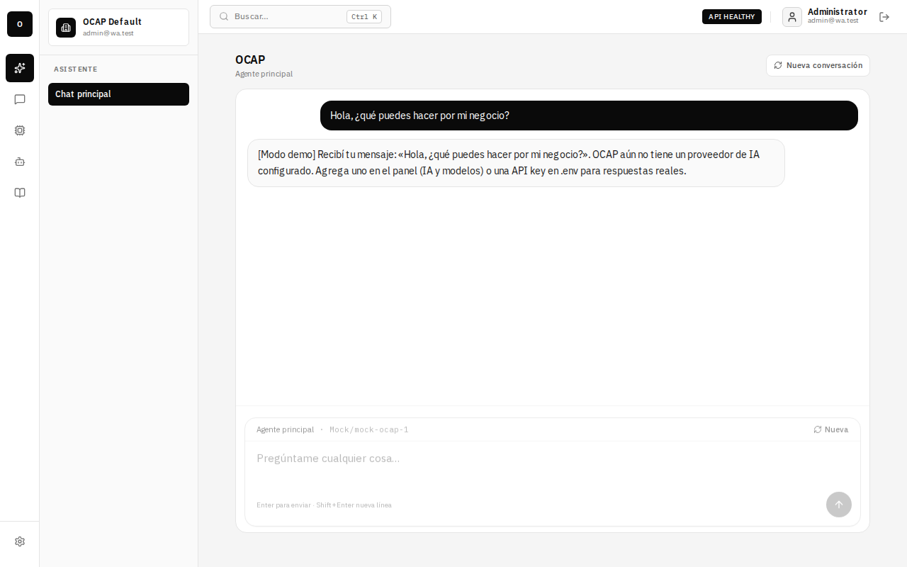
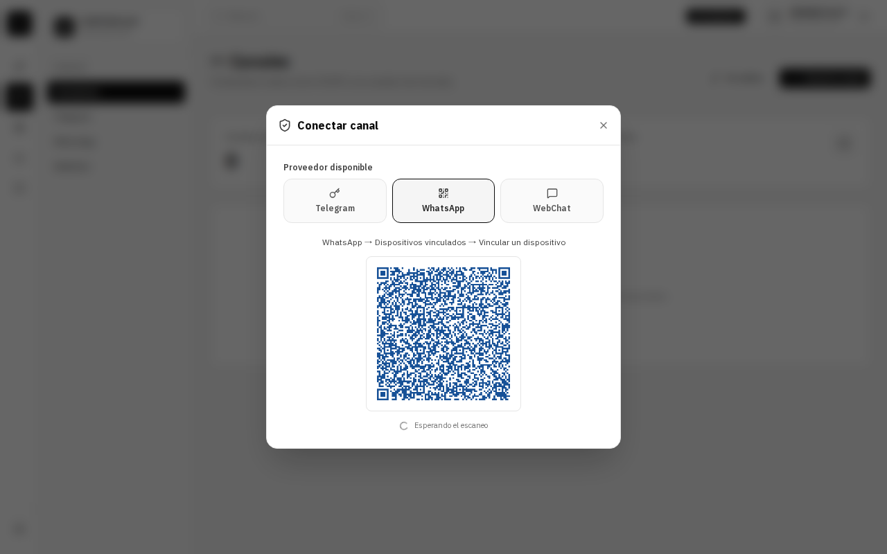
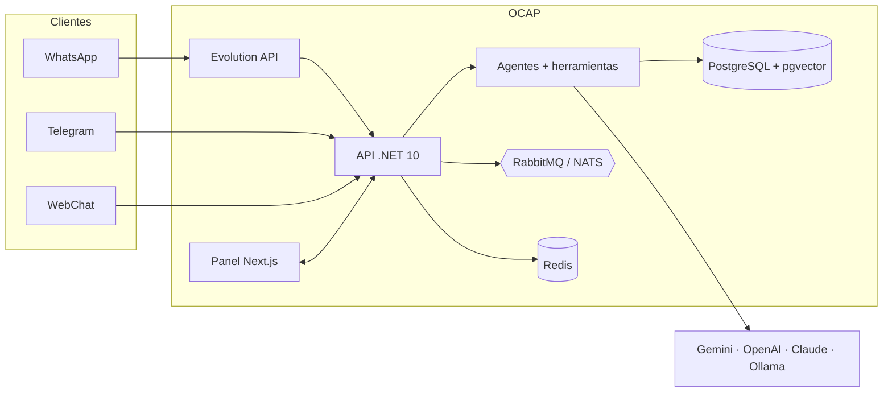

<div align="center">

# OCAP · Open Conversational Automation Platform

**Plataforma self-hosted para atender a tus clientes con agentes de IA en WhatsApp, Telegram y la web, desde un
solo panel y en tu propio equipo o servidor.**

[](https://github.com/Tomfmp2/OCAP-Open-Conversational-Automation-Platform/actions/workflows/ci.yml)
[](LICENSE)


**Backend**


**Frontend**


**Datos y mensajería**


**IA y canales**


**Infraestructura, observabilidad y pruebas**


</div>

| Asistente principal | Vincular WhatsApp por QR |
| --- | --- |
|  |  |

---

## Contenido

- [Qué es OCAP](#qué-es-ocap)
- [Características](#características)
- [Requisitos](#requisitos)
- [Instalación](#instalación)
- [Guía de uso paso a paso](#guía-de-uso-paso-a-paso)
- [El comando `ocap`](#el-comando-ocap)
- [Configuración](#configuración)
- [Arquitectura](#arquitectura)
- [Servicios y puertos](#servicios-y-puertos)
- [Seguridad](#seguridad)
- [Salud y observabilidad](#salud-y-observabilidad)
- [Desarrollo](#desarrollo)
- [Pruebas y CI](#pruebas-y-ci)
- [Solución de problemas](#solución-de-problemas)
- [Documentación](#documentación)
- [Licencia](#licencia)

## Qué es OCAP

OCAP conecta tus canales de mensajería con agentes de IA que responden a tus clientes con tus propias
instrucciones y tu base de conocimiento. Cuando hace falta una persona, alguien del equipo toma la conversación
desde la bandeja y la devuelve al agente al terminar.

Se instala con un comando y corre completo en Docker: tus datos, conversaciones y API keys se quedan en tu
infraestructura. Cada organización (tenant) tiene sus propios usuarios, canales, agentes y proveedores de IA.

> El proyecto está en desarrollo activo. Que exista una abstracción o un proyecto de proveedor no implica que esa
> integración esté completa para producción: el estado real de cada área está en la tabla de abajo.

## Características

| Área | Estado |
| --- | --- |
| Instalación con un comando (`ocap install`) y arranque con `ocap`; asistente en español o inglés | ✅ Listo |
| Asistente principal en el panel, con modo demo si todavía no hay keys de IA | ✅ Listo |
| Agentes por canal: instrucciones propias, historial, base de conocimiento, chat de prueba y pase a una persona | ✅ Listo |
| Bandeja de conversaciones: ver los chats de WhatsApp y Telegram, tomarlos, responder y devolverlos al agente | ✅ Listo |
| IA y modelos por organización (Gemini, OpenAI, Claude, Ollama) con keys cifradas y un proveedor distinto por canal | ✅ Listo |
| WhatsApp por QR (Evolution API v2) | ✅ Listo ([guía](docs/channels/WHATSAPP.md)) |
| WhatsApp Cloud API (Meta) | ✅ Listo con `WhatsApp__AppSecret` |
| Telegram (bot conectado desde el panel, por polling o webhook) | ✅ Listo |
| WebChat: conversación de prueba dentro del panel | ✅ Listo |
| WebChat: widget público para incrustar en tu sitio | ⛔ Pendiente |
| Editar y eliminar canales desde el panel (desvincula WhatsApp y quita el webhook de Telegram) | ✅ Listo |
| Base de conocimiento con búsqueda semántica (pgvector) | ✅ Listo |
| Google Calendar, Gmail y Sheets | 🟡 Disponible con token OAuth |
| Motor de workflows | 🟡 Solo API; fuera de la interfaz de la v1 |
| Slack, Teams, Discord; Qdrant, Chroma, Pinecone | ⛔ No implementado |

El estado detallado de lo pendiente está en [`docs/roadmap/ROADMAP.md`](docs/roadmap/ROADMAP.md).

## Requisitos

| | Mínimo |
| --- | --- |
| Sistema | Linux (Arch, CachyOS, Manjaro, Ubuntu, Debian, Mint, Fedora, RHEL), macOS, o Windows con WSL2 |
| Docker | Docker Engine con Compose v2. **El instalador lo instala si falta.** |
| Memoria | 4 GB de RAM libres para el stack completo |
| Disco | ~5 GB para imágenes y datos |
| IA (opcional) | Una API key de Gemini, OpenAI o Claude, u Ollama en tu equipo. Sin ninguna, OCAP funciona en modo demo. |

## Instalación

### Opción A · Una línea (recomendada)

```bash
curl -fsSL https://raw.githubusercontent.com/Tomfmp2/OCAP-Open-Conversational-Automation-Platform/main/install.sh | bash
```

Descarga OCAP en `~/ocap` y ejecuta `ocap install`.

### Opción B · Desde un clon

```bash
git clone https://github.com/Tomfmp2/OCAP-Open-Conversational-Automation-Platform.git ocap
cd ocap
./ocap install
```

### Qué pregunta el instalador

1. **Idioma**: español o inglés. Lo usan el instalador, el comando `ocap` y las respuestas del asistente.
2. **Organización**: el nombre de tu empresa o proyecto.
3. **Cuenta de administrador**: nombre, correo y contraseña (mínimo 12 caracteres, con letras y números). La
   contraseña no se muestra al escribirla y se pide dos veces.
4. **Proveedor de IA** (opcional): Gemini, OpenAI o Claude con su API key. Puedes omitirlo y agregarlo luego en el
   panel.
5. **Acceso desde tu red**: si quieres abrir el panel desde el celular u otra PC de tu red.
6. **Navegador**: si `ocap` lo abre al arrancar.
7. **Inicio automático**: si OCAP arranca solo al encender el equipo (systemd de usuario en Linux, LaunchAgent en
   macOS).

Luego revisa los puertos (si alguno está ocupado, propone otro), muestra un resumen y, al confirmar:

- instala lo que falte (Docker con Compose, git, curl) con el gestor del sistema: `pacman`, `apt` con el
  repositorio oficial de Docker, `dnf`, o Homebrew + Colima en macOS;
- genera el `.env` con secretos aleatorios;
- construye las imágenes y deja el comando `ocap` disponible en cualquier terminal;
- borra del `.env` la contraseña del administrador en cuanto la cuenta queda creada.

> Agregar tu usuario al grupo `docker` equivale a darle permisos de administrador del sistema. El instalador lo
> hace para que `ocap` funcione sin `sudo`.

### Instalación sin preguntas (servidores, scripts)

```bash
OCAP_YES=1 OCAP_LANG=es OCAP_ORG_NAME="Mi empresa" \
OCAP_ADMIN_EMAIL=admin@miempresa.com OCAP_ADMIN_PASSWORD='una-contraseña-larga-123' \
OCAP_AUTOSTART=1 ./ocap install
```

## Guía de uso paso a paso

### 1. Arranca OCAP y entra al panel

```bash
ocap
```

Enciende Docker si está apagado, levanta todos los servicios, espera a que respondan y abre
`http://localhost:3000`. Entra con el correo y la contraseña que diste en la instalación.

> Si no creaste la cuenta durante la instalación, `ocap` muestra un **código de configuración** de un solo uso.
> Ábrelo en `http://localhost:3000/setup` para crear el administrador.

### 2. Conecta un proveedor de IA (**IA y modelos**)

1. En el menú lateral, abre **IA y modelos**.
2. Pulsa **Registrar proveedor** y elige Gemini, OpenAI, Claude u Ollama.
3. Pega la **API key** (en Ollama, la Base URL de tu servidor) y elige el modelo.
4. Pulsa **Guardar en vault**: la key se guarda cifrada y nunca vuelve al navegador.
5. Pulsa **Probar** para comprobar la conexión y **Usar** para que sea la IA activa de la organización.

Sin ningún proveedor, el asistente responde en **modo demo** con un proveedor simulado, útil para recorrer el panel.

### 3. Prueba el asistente principal (**Asistente**)

La pantalla de inicio es un chat con el asistente de la organización. Úsalo para hacer preguntas y comprobar que
la IA responde antes de ponerla frente a tus clientes.

### 4. Crea un agente para tus clientes (**Agentes**)

1. Abre **Agentes** y pulsa **Crear agente**.
2. Ponle un nombre (por ejemplo, *Ventas*) y escribe sus instrucciones: qué atiende, en qué tono y qué no debe
   hacer. Por ejemplo: *"Informas precios y horarios solo si están en la base de conocimiento."*
3. Elige qué herramientas puede usar (por ejemplo, crear eventos en el calendario o agregar filas a una hoja).
4. Prueba el agente en su **chat de prueba**: en este modo dice qué haría, pero no ejecuta acciones reales.

Si no creas ninguno, los canales usan el **agente de atención por defecto**.

### 5. Carga tu información (**Conocimiento**)

1. Abre **Conocimiento** y crea una **Nueva base de conocimiento** (PgVector es el motor recomendado).
2. Selecciónala y pulsa **Subir documento**: precios, preguntas frecuentes, políticas, catálogos.
3. Usa **Búsqueda semántica** para comprobar qué encuentra el agente.

### 6. Conecta un canal (**Canales**)

Abre **Canales** y pulsa **Conectar canal**:

| Canal | Cómo se conecta |
| --- | --- |
| **WhatsApp** | Elige WhatsApp y escanea el QR desde *WhatsApp → Dispositivos vinculados* en tu teléfono. La tarjeta pasa de *Esperando escaneo* a *Conectado*. ([guía](docs/channels/WHATSAPP.md)) |
| **Telegram** | Crea un bot con [@BotFather](https://t.me/BotFather), copia su token y pégalo en **Bot API Token**. |
| **WebChat** | Ponle un nombre y un título; en **Canales → WebChat** lo pruebas dentro del panel. El widget público para tu sitio todavía no está disponible. |

### 7. Elige agente e IA de cada canal

Cada tarjeta de canal tiene dos selectores:

- **Agente que responde**: el agente del paso 4, o el de atención por defecto.
- **IA que usa**: un proveedor concreto de **IA y modelos**, o *La activa de la organización*. Si el proveedor
  asignado se deshabilita o se borra, el canal vuelve a la IA de la organización y no se queda sin responder.

Con el lápiz cambias el nombre del canal y con la papelera lo eliminas. Al eliminar WhatsApp se cierra la sesión
en tu teléfono y, para volver a usarlo, hay que escanear el QR otra vez. Las conversaciones se conservan.

### 8. Atiende desde la bandeja (**Conversaciones**)

- Ves en vivo los chats de WhatsApp y Telegram con lo que respondió el agente.
- **Tomar conversación** detiene al agente y te deja responder tú desde el panel.
- **Devolver al agente** reanuda las respuestas automáticas.
- Si un cliente pide hablar con una persona, el agente transfiere la conversación por sí solo.

## El comando `ocap`

| Comando | Qué hace |
| --- | --- |
| `ocap` | Levanta OCAP y abre el panel; si el código cambió, reconstruye |
| `ocap start --build` | Igual, pero fuerza la reconstrucción |
| `ocap stop` | Lo apaga (los datos se conservan) |
| `ocap restart` | `stop` + `start` |
| `ocap status` | Estado de los servicios |
| `ocap logs [servicio]` | Logs en vivo, por ejemplo `ocap logs ocap-api` |
| `ocap config` | Cambia idioma, IA, acceso desde la red, puertos e inicio automático |
| `ocap autostart on\|off` | Inicia (o no) OCAP al encender el equipo |
| `ocap update` | `git pull` + reconstruir + levantar |
| `ocap reset` | Borra **todos** los datos y empieza de cero (pide confirmación) |
| `ocap uninstall` | Quita el comando y el inicio automático (no borra el repo ni los datos) |
| `ocap help` | Ayuda |

## Configuración

Lo normal es no editar el `.env` a mano: `ocap install` y `ocap config` preguntan lo necesario y lo escriben.
Las variables más relevantes (referencia completa en [`.env.example`](.env.example)):

| Variable | Para qué sirve | Por defecto |
| --- | --- | --- |
| `OCAP_LANGUAGE` | Idioma del instalador, de `ocap` y del asistente (`es` / `en`) | `es` |
| `OCAP_BIND_ADDRESS` | `127.0.0.1` solo este equipo; `0.0.0.0` también tu red | `127.0.0.1` |
| `FRONTEND_HOST_PORT` / `API_HOST_PORT` | Puertos del panel y de la API | `3000` / `5000` |
| `PUBLIC_PANEL_URL` | URL pública del panel (enlaces, CORS) | `http://localhost:3000` |
| `EVENTBUS_PROVIDER` | Bus de eventos: `RabbitMQ`, `Nats` o `InMemory` | `RabbitMQ` |
| `STORAGE_PROVIDER` | Almacenamiento de archivos | `Local` |
| `AiProviders__<Proveedor>__ApiKey` | Key de IA por entorno (alternativa al panel) | vacía |
| `AiProviders__DemoMode` | `false` desactiva el proveedor simulado | activo sin keys |
| `WhatsApp__AppSecret` | Firma de Meta para WhatsApp Cloud API | vacía |
| `POSTGRES_PASSWORD`, `JWT_SECRET_KEY`, `VAULT_MASTER_KEY`, `EVOLUTION_API_KEY` | Secretos; se generan solos si están vacíos | aleatorios |

> No compartas el `.env` ni lo subas al repositorio: contiene los secretos de tu instalación. Cambiar
> `VAULT_MASTER_KEY` deja ilegibles las API keys ya guardadas.

## Arquitectura



El backend sigue una arquitectura por capas (dominio → aplicación → infraestructura / API) dividida en módulos:

```
src/
├── Api/             API ASP.NET Core: controladores, middlewares, autenticación
├── Core/            Dominio: conversaciones, mensajes, usuarios, puertos
├── Application/     Casos de uso
├── Infrastructure/  EF Core, vault de credenciales, servicios
├── Modules/         Agentes (dominio, aplicación, abstracciones)
├── Channels/        Telegram, WhatsApp (Evolution y Cloud API), WebChat
├── Intelligence/    Abstracciones y registro de proveedores de IA
├── Providers/       Gemini, OpenAI, Claude, Ollama, Google, almacenamiento
├── Knowledge/       Base de conocimiento y búsqueda vectorial
├── Security/        Identidad, tenants, RBAC
├── Tools/           Herramientas que pueden usar los agentes
└── Workflow/        Motor de workflows (solo API en la v1)
frontend/            Panel Next.js 16 (App Router)
docker/              Imágenes y compose de CI
scripts/             Instalador, CI local, desarrollo
tests/               Pruebas unitarias, de integración y de endpoints
```

Más detalle en [`docs/architecture/`](docs/architecture/) y [`docs/intelligence/ARCHITECTURE.md`](docs/intelligence/ARCHITECTURE.md).

## Servicios y puertos

Solo el panel, la API y Nginx siguen `OCAP_BIND_ADDRESS`. El resto queda siempre en `127.0.0.1`, porque no debe
exponerse a la red. Todos los puertos se cambian en el `.env` (o con `ocap config`).

| Servicio | Puerto en el host | Expuesto a la red |
| --- | --- | --- |
| Panel (Next.js) | `3000` | según `OCAP_BIND_ADDRESS` |
| API | `5000` | según `OCAP_BIND_ADDRESS` |
| Nginx | `80` | según `OCAP_BIND_ADDRESS` |
| PostgreSQL + pgvector | `5433` | no |
| Redis | `6379` | no |
| RabbitMQ (AMQP / administración) | `5672` / `15672` | no |
| NATS (cliente / monitorización) | `4222` / `8222` | no |
| Evolution API (WhatsApp) | `8088` | no |
| Jaeger (UI / OTLP gRPC / OTLP HTTP) | `16686` / `4317` / `4318` | no |
| Prometheus | `9090` | no |

## Seguridad

- **Sin credenciales por defecto.** El administrador se crea en la instalación o en `/setup` con un código de un
  solo uso que la API imprime en sus logs.
- **Keys cifradas.** Las API keys de IA, los tokens de canales y de Google, los secretos de webhooks y la contraseña
  LDAP se guardan cifrados (AES-256-GCM, una clave por organización) en el vault y no salen de la API.
- **Sesión fuera del alcance de JavaScript.** El refresh token viaja en una cookie `HttpOnly` y se guarda como hash;
  el panel no escribe la sesión en `localStorage`. Reusar un token ya rotado cierra esa sesión.
- **Aislamiento por organización.** Filtros por tenant en la base de datos y comprobación explícita en las rutas
  que reciben un `tenantId`.
- **Webhooks firmados.** Evolution, Telegram y Meta se verifican con su firma o secreto antes de procesar mensajes.
- **API**: JWT por defecto, validación con FluentValidation, errores RFC 7807 (`application/problem+json`) y
  cabeceras de seguridad. Detalle en [`docs/API_GOVERNANCE.md`](docs/API_GOVERNANCE.md) y [`docs/security/`](docs/security/).

Para despliegues automatizados, el administrador se puede crear desde el entorno con `BOOTSTRAP_ADMIN_EMAIL` y
`BOOTSTRAP_ADMIN_PASSWORD` (mínimo 12 caracteres, con letras y números).

## Salud y observabilidad

| Endpoint | Uso |
| --- | --- |
| `GET /health/live` | El proceso responde |
| `GET /health/ready` | Listo para atender (lo usa Docker) |
| `GET /health/startup` | Arranque completado |
| `GET /api/health`, `/api/health/system`, `/api/health/diagnostic` | Estado detallado |
| `GET /metrics` | Métricas en formato Prometheus |

Las trazas se exportan por OpenTelemetry (OTLP 1.17) a Jaeger (`http://localhost:16686`) y las métricas a
Prometheus (`http://localhost:9090`). Ver [`docs/infrastructure/OPENTELEMETRY.md`](docs/infrastructure/OPENTELEMETRY.md).

## Desarrollo

Requisitos: [.NET SDK 10](https://dotnet.microsoft.com/download), Node.js 20 o superior y, para el stack
completo, Docker.

**Todo en una terminal, sin Docker** (API en memoria en `:5229` y panel en `:3000`):

```bash
./scripts/ocap-dev.sh          # Linux y macOS
.\scripts\ocap-dev.ps1         # Windows (PowerShell)
```

**Por separado:**

```bash
# Backend
dotnet restore OCAP.slnx
dotnet build OCAP.slnx
dotnet run --project src/Api/OCAP.Api

# Frontend
cd frontend
npm install
npm run dev
```

La configuración base está en `src/Api/OCAP.Api/appsettings.json`. Los valores sensibles se pasan por variables de
entorno o secretos, nunca en el repositorio.

## Pruebas y CI

```bash
dotnet test OCAP.slnx                       # backend: unitarias, integración y endpoints
cd frontend && npm test                     # frontend: Vitest + Testing Library
cd frontend && npm run lint && npx tsc --noEmit
```

`./scripts/ci-local.sh` corre las mismas comprobaciones que [`ci.yml`](.github/workflows/ci.yml) sin depender de
GitHub Actions:

| Opción | Qué agrega |
| --- | --- |
| *(sin opciones)* | Build del backend sin avisos y sus pruebas; lint, tipos, pruebas y build del frontend; dependencias vulnerables |
| `--docker` | Imágenes Docker escaneadas con Trivy |
| `--e2e` | Smoke de Playwright (escritorio y móvil) sobre un stack aislado; no toca tu `.env` ni un OCAP en marcha |
| `--all` | Todo lo anterior (unos 6 minutos) |

Para que corra solo antes de cada `git push`, activa el hook una vez por clon:

```bash
git config core.hooksPath .githooks
```

Para saltarlo puntualmente: `OCAP_SKIP_CI=1 git push`.

## Solución de problemas

| Síntoma | Qué hacer |
| --- | --- |
| `ocap: command not found` | Abre una terminal nueva, o agrega `~/.local/bin` a tu `PATH`. |
| Un puerto está ocupado | `ocap config` y elige otro; el instalador ya propone puertos libres. |
| El asistente responde con textos de ejemplo | Está en modo demo: registra un proveedor en **IA y modelos** y pulsa **Usar**. |
| WhatsApp se queda en *Esperando escaneo* | Genera el QR otra vez (caduca en poco tiempo) y revisa `ocap logs evolution-api`. |
| El panel no carga | `ocap status` y `ocap logs ocap-api`; la API debe estar `healthy`. |
| `permission denied` al usar Docker | Cierra sesión y vuelve a entrar para que se aplique el grupo `docker`. |
| Quiero empezar de cero | `ocap reset` borra todos los datos (pide confirmación). |

## Documentación

| Tema | Documento |
| --- | --- |
| Primer arranque y `/setup` | [`docs/deployment/FIRST_RUN_SETUP.md`](docs/deployment/FIRST_RUN_SETUP.md) |
| WhatsApp por QR | [`docs/channels/WHATSAPP.md`](docs/channels/WHATSAPP.md) |
| Proveedores de IA y keys por canal | [`docs/intelligence/AI_PROVIDERS.md`](docs/intelligence/AI_PROVIDERS.md) |
| Gobernanza de la API | [`docs/API_GOVERNANCE.md`](docs/API_GOVERNANCE.md) |
| Seguridad, tenants y RBAC | [`docs/security/`](docs/security/) |
| Observabilidad | [`docs/infrastructure/OPENTELEMETRY.md`](docs/infrastructure/OPENTELEMETRY.md) |
| Pruebas end-to-end | [`docs/testing/E2E_CRITICAL_PATH.md`](docs/testing/E2E_CRITICAL_PATH.md) |
| Decisiones de arquitectura | [`docs/adr/`](docs/adr/) |
| Roadmap | [`docs/roadmap/ROADMAP.md`](docs/roadmap/ROADMAP.md) |
| Historial de cambios | [`CHANGELOG.md`](CHANGELOG.md) |

## Licencia

Distribuido bajo la licencia [Apache 2.0](LICENSE).
