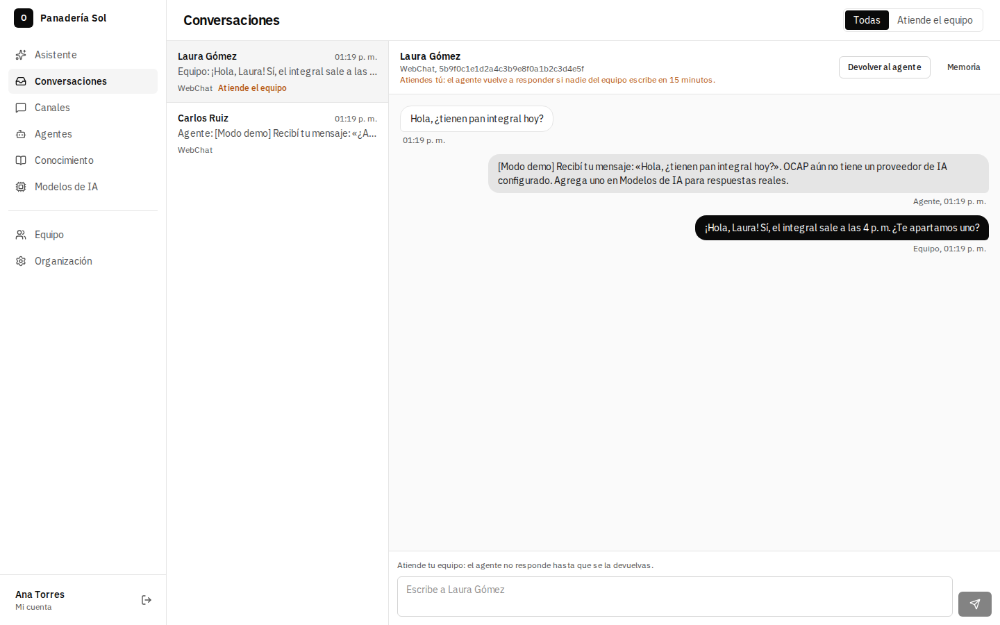
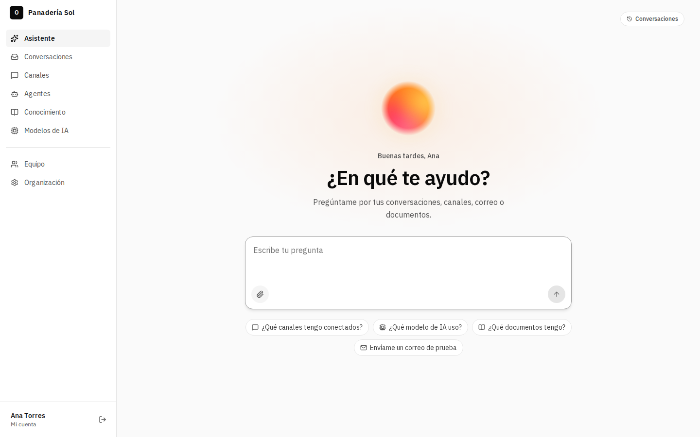
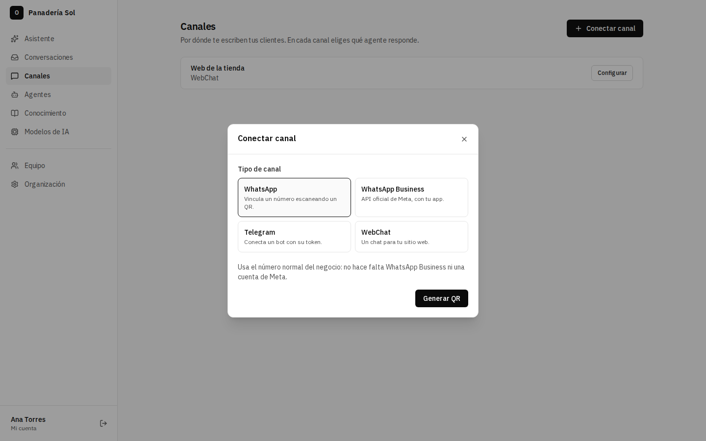
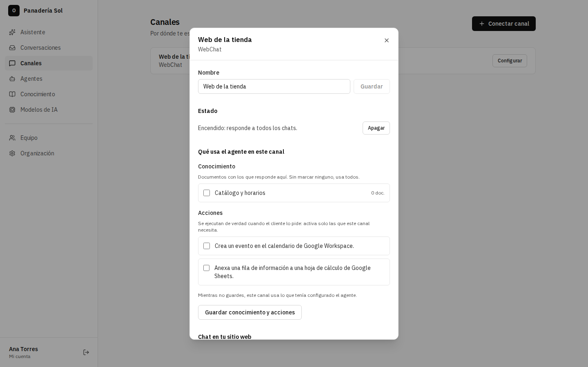
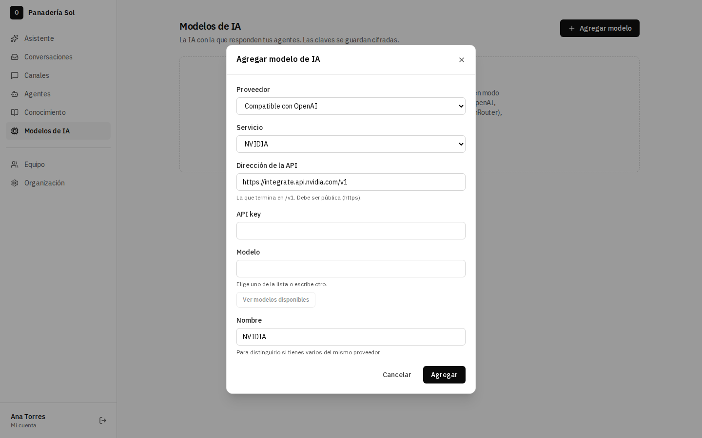
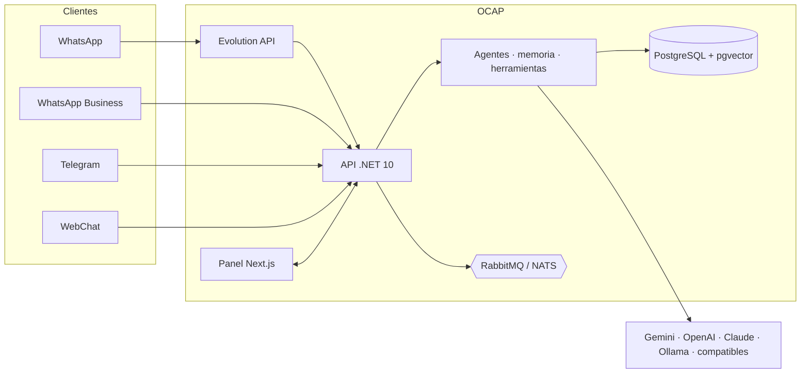

<div align="center">

# OCAP · Open Conversational Automation Platform

**Atiende a tus clientes con agentes de IA en WhatsApp, Telegram y tu web, desde un solo panel y en tu propio
servidor.**

[](https://github.com/Tomfmp2/OCAP-Open-Conversational-Automation-Platform/actions/workflows/ci.yml)
[](LICENSE)


</div>



| Asistente del panel | Conectar un canal |
| --- | --- |
|  |  |
| **Qué usa el agente en cada canal** | **Modelos de IA** |
|  |  |

---

## Contenido

- [Qué es OCAP](#qué-es-ocap)
- [Qué incluye la v1](#qué-incluye-la-v1)
- [Requisitos](#requisitos)
- [Instalación](#instalación)
- [Primeros pasos](#primeros-pasos)
- [El comando `ocap`](#el-comando-ocap)
- [Configuración](#configuración)
- [Seguridad y privacidad](#seguridad-y-privacidad)
- [Arquitectura](#arquitectura)
- [Servicios y puertos](#servicios-y-puertos)
- [Salud y observabilidad](#salud-y-observabilidad)
- [Desarrollo](#desarrollo)
- [Pruebas y CI](#pruebas-y-ci)
- [Solución de problemas](#solución-de-problemas)
- [Documentación](#documentación)
- [Licencia](#licencia)

## Qué es OCAP

OCAP conecta tus canales de mensajería con agentes de IA que responden a tus clientes con tus instrucciones y tus
documentos. Cuando hace falta una persona, alguien del equipo toma la conversación desde la bandeja; si se olvida
de devolverla, el agente la retoma solo a los 15 minutos.

Se instala con un comando y corre completo en Docker: conversaciones, documentos y API keys se quedan en tu
infraestructura. Cada organización tiene sus propios usuarios, canales, agentes, modelos de IA y conocimiento,
aislados también en la base de datos.

## Qué incluye la v1

**Canales**

- **WhatsApp** con el número normal del negocio, vinculado por QR (Evolution API). El QR sale en negro sobre
  blanco para que el teléfono lo lea sin problemas.
- **WhatsApp Business** (API oficial de Meta): se conecta desde el panel con tu App Secret; OCAP genera el token de
  verificación del webhook. No hay que tocar el `.env`.
- **Telegram**: uno o varios bots, cada uno con su token.
- **WebChat**: un widget para tu web, limitado a tus dominios y con clave rotable.
- **Varios canales del mismo tipo**, cada uno con su agente, su modelo de IA, su conocimiento y sus acciones.
- **Apagado sin cortes**: «Apagar» deja de aceptar chats nuevos, termina los que están en curso (5 minutos sin
  mensajes) y apaga el canal hasta que lo enciendas.

**Agentes**

- Instrucciones propias, chat de prueba y pase a una persona cuando el cliente lo pide.
- **El canal decide** qué colecciones de conocimiento consulta el agente y qué acciones puede ejecutar (crear un
  evento en Google Calendar, anotar una fila en Google Sheets): el mismo agente puede atender distinto en cada canal.
- **Memoria**: recuerda a cada cliente entre conversaciones (nombre, ciudad, preferencias, pedidos) durante el plazo
  que elijas (90 días por defecto). Los clientes pueden pedir «olvídame». Las conversaciones largas se resumen solas
  para que el costo por mensaje no crezca.

**Conocimiento**

- Lee **PDF, Word, Excel, CSV**, Markdown, JSON, HTML y texto. En Excel y CSV cada fila conserva sus encabezados
  («Producto: Empanada; Precio: 2500»), así el agente sabe qué es cada valor.
- Arrastrar y soltar, **escribir respuestas** a preguntas frecuentes e **importar páginas web**.
- «Ver contenido» muestra el texto exacto que usa el agente, y «Probar» enseña qué encontraría ante una pregunta.

**Modelos de IA**

- Gemini, OpenAI, Claude, Ollama (local) y cualquier API **compatible con OpenAI** (NVIDIA, Groq, OpenRouter,
  DeepSeek, Mistral…), con varias configuraciones del mismo proveedor.
- «Ver modelos disponibles» lista los modelos que ofrece el proveedor con tu clave.
- Sin ninguna clave, OCAP funciona en **modo demo** para recorrer el panel.

**Asistente del panel**

- Responde sobre el estado de tu organización (canales, agentes, documentos) y puede enviar correos o crear
  eventos con Google Workspace.
- Guarda tus conversaciones para retomarlas, recuerda lo que le cuentas y acepta imágenes, video (con Gemini) y
  documentos adjuntos.

**Organización y equipo**

- Invitaciones al equipo con roles, recuperación de contraseña por correo.
- Desde **Organización**: correo saliente (SMTP), Google Workspace, idioma y zona horaria del asistente, dirección
  del panel, retención de conversaciones, plazo de memoria y aviso de tratamiento de datos.

**Fuera de la v1**: el motor de workflows existe solo por API, sin interfaz. Slack, Teams y Discord no están
implementados. Lo que viene está en [`docs/roadmap/ROADMAP.md`](docs/roadmap/ROADMAP.md).

## Requisitos

| | Mínimo |
| --- | --- |
| Sistema | Linux (Arch, CachyOS, Manjaro, Ubuntu, Debian, Mint, Fedora, RHEL), macOS, o Windows con WSL2 |
| Docker | Docker Engine con Compose v2. **El instalador lo instala si falta.** |
| Memoria | 4 GB de RAM libres para el stack completo |
| Disco | ~5 GB para imágenes y datos |
| IA (opcional) | Una API key de Gemini, OpenAI, Claude o un servicio compatible, u Ollama en tu equipo |

## Instalación

### Opción A · Una línea (recomendada)

```bash
curl -fsSL https://raw.githubusercontent.com/Tomfmp2/OCAP-Open-Conversational-Automation-Platform/main/install.sh | bash
```

Descarga OCAP en `~/ocap` y ejecuta `ocap install`.

### Opción B · Desde un clon

```bash
git clone https://github.com/Tomfmp2/OCAP-Open-Conversational-Automation-Platform.git ocap
cd ocap
./ocap install
```

### Qué pregunta el instalador

1. **Idioma**: español o inglés (instalador, comando `ocap` y asistente).
2. **Organización**: el nombre de tu empresa o proyecto.
3. **Cuenta de administrador**: nombre, correo y contraseña (mínimo 12 caracteres, con letras y números).
4. **Proveedor de IA** (opcional): puedes omitirlo y agregarlo luego en el panel.
5. **Acceso desde tu red**, **abrir el navegador** al arrancar e **inicio automático** con el equipo.

Después revisa los puertos (propone otros si alguno está ocupado), instala lo que falte (Docker, git, curl), genera
el `.env` con secretos aleatorios, construye las imágenes y deja el comando `ocap` disponible. La contraseña del
administrador se borra del `.env` en cuanto la cuenta queda creada.

> Agregar tu usuario al grupo `docker` equivale a darle permisos de administrador del sistema. El instalador lo
> hace para que `ocap` funcione sin `sudo`.

### Instalación sin preguntas (servidores, scripts)

```bash
OCAP_YES=1 OCAP_LANG=es OCAP_ORG_NAME="Mi empresa" \
OCAP_ADMIN_EMAIL=admin@miempresa.com OCAP_ADMIN_PASSWORD='una-contraseña-larga-123' \
OCAP_AUTOSTART=1 ./ocap install
```

## Primeros pasos

1. **Arranca y entra.** `ocap` levanta los servicios y abre `http://localhost:3000`. Si no creaste la cuenta al
   instalar, `ocap` muestra un código de un solo uso para crearla en `/setup`.
2. **Agrega un modelo** en **Modelos de IA**: elige el proveedor, pega la API key (se guarda cifrada) y pulsa
   **Probar**. Con varios modelos, marca uno como **predeterminado**.
3. **Carga tu información** en **Conocimiento**: arrastra tus PDF, Word o Excel, escribe respuestas a preguntas
   frecuentes o importa una página. Usa **Probar** para ver qué encuentra el agente.
4. **Crea un agente** en **Agentes**: nombre e instrucciones (qué atiende, en qué tono, qué no debe hacer).
   Pruébalo en su chat de prueba. Si no creas ninguno, los canales usan un agente de atención por defecto.
5. **Conecta un canal** en **Canales → Conectar canal**:

   | Canal | Cómo |
   | --- | --- |
   | WhatsApp | **Generar QR** y escanearlo en *WhatsApp → Dispositivos vinculados*. [Guía](docs/channels/WHATSAPP.md) |
   | WhatsApp Business | Phone number ID, token de acceso y App Secret de tu app de Meta; copia en Meta la URL y el token que muestra OCAP |
   | Telegram | Crea un bot con [@BotFather](https://t.me/BotFather) y pega su token |
   | WebChat | Ponle nombre; en **Configurar** autorizas tus dominios y copias el `<script>` del widget |

6. **Configura el canal** (**Configurar**): el agente que responde, el modelo de IA y **qué usa el agente en este
   canal** (colecciones y acciones).
7. **Atiende desde Conversaciones**: ves los chats en vivo, **Tomar conversación** para responder tú, **Devolver al
   agente** al terminar y **Memoria** para ver, corregir o borrar lo que se recuerda del cliente.
8. **Ajusta tu organización** en **Organización**: correo saliente para invitaciones, Google Workspace, zona
   horaria, plazo de memoria, retención y aviso de privacidad. Invita a tu equipo en **Equipo**.

Las guías detalladas están en [Documentación](#documentación).

## El comando `ocap`

| Comando | Qué hace |
| --- | --- |
| `ocap` | Levanta OCAP y abre el panel; si el código cambió, reconstruye |
| `ocap start --build` | Igual, forzando la reconstrucción |
| `ocap stop` / `ocap restart` | Lo apaga (los datos se conservan) / lo reinicia |
| `ocap status` | Estado de los servicios |
| `ocap logs [servicio]` | Logs en vivo, por ejemplo `ocap logs ocap-api` |
| `ocap config` | Cambia idioma, IA, acceso desde la red, puertos e inicio automático |
| `ocap autostart on\|off` | Inicia (o no) OCAP al encender el equipo |
| `ocap update` | `git pull` + reconstruir + levantar |
| `ocap backup` | Copia la base y los archivos en `backups/` (el `.env` va aparte: tiene las claves maestras) |
| `ocap restore <archivo>` | Restaura una copia (pide confirmación; necesita el mismo `.env`) |
| `ocap reset` | Borra **todos** los datos y empieza de cero (pide confirmación) |
| `ocap uninstall` | Quita el comando y el inicio automático (no borra el repo ni los datos) |
| `ocap help` | Ayuda |

## Configuración

Casi todo se configura en el panel: modelos de IA, canales, correo, Google Workspace y preferencias se guardan en la
base, con los secretos cifrados. El `.env` lo escriben `ocap install` y `ocap config`, y solo contiene lo del
servidor ([referencia completa](.env.example)):

| Variable | Para qué sirve | Por defecto |
| --- | --- | --- |
| `OCAP_LANGUAGE` | Idioma del instalador, de `ocap` y del asistente (`es` / `en`) | `es` |
| `OCAP_BIND_ADDRESS` | `127.0.0.1` solo este equipo; `0.0.0.0` también tu red | `127.0.0.1` |
| `FRONTEND_HOST_PORT` / `API_HOST_PORT` / `NGINX_HOST_PORT` | Puertos del panel, la API y Nginx | `3000` / `5000` / `80` |
| `PUBLIC_PANEL_URL` | URL pública del panel (enlaces, CORS) | `http://localhost:3000` |
| `OCAP_DOMAIN` / `OCAP_ACME_EMAIL` | HTTPS público: Caddy obtiene el certificado de Let's Encrypt para tu dominio | vacías |
| `POSTGRES_PASSWORD`, `OCAP_DB_APP_PASSWORD`, `REDIS_PASSWORD`, `RABBITMQ_PASSWORD`, `JWT_SECRET_KEY`, `VAULT_MASTER_KEY`, `EVOLUTION_API_KEY` | Secretos; se generan solos | aleatorios |
| `Email__Smtp__*`, `Google__*`, `WhatsAppCloud__*` | Opcionales: valores del servidor que se usan cuando una organización no configuró los suyos en el panel | vacías |

> No compartas el `.env` ni lo subas al repositorio. Cambiar `VAULT_MASTER_KEY` deja ilegibles las claves ya
> guardadas.

## Seguridad y privacidad

- **Sin credenciales por defecto.** El administrador se crea al instalar o en `/setup` con un código de un solo uso.
- **Secretos cifrados.** API keys, tokens de canales, App Secret de WhatsApp, contraseña SMTP y credenciales de
  Google se guardan cifrados (AES-256-GCM) y nunca vuelven al navegador.
- **Aislamiento por organización en dos capas**: filtros en la aplicación y *row-level security* en PostgreSQL con
  un rol de base de datos sin privilegios. Un test impide abrir conexiones que se salten esa capa.
- **Sesión fuera del alcance de JavaScript**: refresh token en cookie `HttpOnly`, guardado como hash y rotado; el
  panel no usa `localStorage` para la sesión.
- **Webhooks firmados** (Evolution, Telegram, Meta) y deduplicados: un mensaje reenviado no se responde dos veces.
- **Red saliente controlada**: las direcciones que escribe un usuario (modelos de IA, páginas a importar, SMTP) no
  pueden apuntar a la red interna, ni siquiera cambiando el DNS después de validarse.
- **IA con límites**: lo que llega de clientes y archivos se trata como datos, no como instrucciones. Una
  conversación con adjuntos no ejecuta acciones, y las acciones de un canal son solo las que ese canal concede.
- **Privacidad**: la memoria caduca sola, «olvídame» la borra, los datos sensibles (tarjetas, contraseñas,
  documentos) no se guardan como recuerdo y puedes enviar un aviso de tratamiento de datos.
- **Permisos**: lo que afecta a cuentas (correo saliente, dirección del panel) exige el permiso de seguridad.

Más en [`docs/security/`](docs/security/) y [`docs/API_GOVERNANCE.md`](docs/API_GOVERNANCE.md).

## Arquitectura



El backend es un monolito modular por capas (dominio → aplicación → infraestructura / API):

```
src/
├── Api/             API ASP.NET Core: controladores, servicios de canal, memoria, jobs
├── Core/            Dominio: conversaciones, mensajes, contactos, memoria
├── Application/     Casos de uso
├── Infrastructure/  EF Core, RLS, vault de credenciales, retención
├── Modules/         Agentes y asistente del panel
├── Channels/        Telegram, WhatsApp (Evolution y Cloud API), WebChat
├── Intelligence/    Abstracciones y registro de proveedores de IA
├── Providers/       Gemini, OpenAI (y compatibles), Claude, Ollama, Google Workspace
├── Knowledge/       Lectores de documentos, fragmentos, embeddings y búsqueda
├── Security/        Identidad, organizaciones, roles
├── Tools/           Acciones que pueden ejecutar los agentes
└── Workflow/        Motor de workflows (solo API)
frontend/            Panel Next.js 16 (App Router)
docker/              Imágenes y compose de CI
scripts/             Instalador, CI local, desarrollo
tests/               Pruebas unitarias, de integración, de endpoints y sobre PostgreSQL
```

Las decisiones de diseño están en [`docs/adr/`](docs/adr/).

## Servicios y puertos

Solo el panel, la API y Nginx siguen `OCAP_BIND_ADDRESS`; el resto escucha siempre en `127.0.0.1`.

| Servicio | Puerto en el host | Expuesto a la red |
| --- | --- | --- |
| Panel (Next.js) | `3000` | según `OCAP_BIND_ADDRESS` |
| API | `5000` | según `OCAP_BIND_ADDRESS` |
| Nginx | `80` | según `OCAP_BIND_ADDRESS` |
| PostgreSQL + pgvector | `5433` | no |
| Redis (solo caché de Evolution) | `6379` | no |
| RabbitMQ (AMQP / administración) | `5672` / `15672` | no |
| NATS (cliente / monitorización) | `4222` / `8222` | no |
| Evolution API (WhatsApp) | `8088` | no |
| Jaeger (UI / OTLP) | `16686` / `4317`, `4318` | no |
| Prometheus | `9090` | no |

## Salud y observabilidad

| Endpoint | Uso |
| --- | --- |
| `GET /health/live` · `/health/ready` · `/health/startup` | Proceso vivo, listo (lo usa Docker), arranque completado |
| `GET /api/health`, `/api/health/system` | Estado detallado |
| `GET /metrics` | Métricas en formato Prometheus |

Trazas por OpenTelemetry a Jaeger (`http://localhost:16686`) y métricas a Prometheus (`http://localhost:9090`).
Cuando un canal no responde, los logs de `ocap-api` dicen por qué (canal apagado, conversación atendida por una
persona, rechazo del proveedor con su motivo). Ver [`docs/infrastructure/OPENTELEMETRY.md`](docs/infrastructure/OPENTELEMETRY.md).

## Desarrollo

Requisitos: [.NET SDK 10](https://dotnet.microsoft.com/download), Node.js 20 o superior y Docker.

```bash
./scripts/ocap-dev.sh          # API en memoria (:5229) y panel (:3000), sin Docker. Windows: .\scripts\ocap-dev.ps1

# Por separado
dotnet build OCAP.slnx && dotnet run --project src/Api/OCAP.Api
cd frontend && npm install && npm run dev
```

Las migraciones se crean con `dotnet ef migrations add <Nombre> -p src/Infrastructure/OCAP.Infrastructure -s src/Api/OCAP.Api`
y se aplican al arrancar (`ocap-migrate`). Los secretos van por variables de entorno, nunca en el repositorio.

## Pruebas y CI

```bash
dotnet test OCAP.slnx                          # backend
OCAP_TEST_DATABASE=postgres dotnet test tests/OCAP.Api.Tests   # API sobre PostgreSQL real (Testcontainers, RLS)
cd frontend && npm test && npm run lint && npx tsc --noEmit
```

`./scripts/ci-local.sh` corre lo mismo que [`ci.yml`](.github/workflows/ci.yml) sin GitHub Actions:

| Opción | Qué agrega |
| --- | --- |
| *(sin opciones)* | Build sin avisos y pruebas del backend (también sobre PostgreSQL); lint, tipos, pruebas y build del frontend; dependencias vulnerables |
| `--docker` | Imágenes Docker escaneadas con Trivy |
| `--e2e` | Playwright (escritorio, móvil y accesibilidad con axe) sobre un stack aislado que no toca tu `.env` |
| `--all` | Todo lo anterior |

Para correrlo antes de cada `git push`: `git config core.hooksPath .githooks` (una vez por clon).

## Solución de problemas

| Síntoma | Qué hacer |
| --- | --- |
| `ocap: command not found` | Abre una terminal nueva o agrega `~/.local/bin` a tu `PATH` |
| Un puerto está ocupado | `ocap config` y elige otro |
| El agente responde «[Modo demo]» | Agrega un modelo en **Modelos de IA** |
| El bot no responde | En **Conversaciones**, mira si la atiende una persona (**Devolver al agente**) y en **Canales** si el canal está encendido; luego `ocap logs ocap-api` |
| «Se agotó la cuota del proveedor de IA» | Es el límite de tu plan con el proveedor; espera o usa otro modelo |
| WhatsApp se queda esperando el escaneo | Genera el QR otra vez (caduca rápido) y revisa `ocap logs evolution-api` |
| Un PDF no aporta nada al agente | Si es un escaneo no tiene texto; **Ver contenido** muestra lo que se leyó |
| `permission denied` con Docker | Cierra sesión y vuelve a entrar para aplicar el grupo `docker` |

## Documentación

| Tema | Documento |
| --- | --- |
| Canales: Telegram, WebChat, WhatsApp Business, apagado y traspaso a personas | [`docs/guides/CHANNELS.md`](docs/guides/CHANNELS.md) |
| WhatsApp por QR | [`docs/channels/WHATSAPP.md`](docs/channels/WHATSAPP.md) |
| Conocimiento: formatos, Excel, fragmentos y búsqueda | [`docs/guides/KNOWLEDGE.md`](docs/guides/KNOWLEDGE.md) |
| Memoria de los agentes y privacidad | [`docs/guides/MEMORY.md`](docs/guides/MEMORY.md) |
| Organización: correo, Google Workspace, preferencias | [`docs/guides/ORGANIZATION.md`](docs/guides/ORGANIZATION.md) |
| Modelos de IA y proveedores compatibles | [`docs/intelligence/AI_PROVIDERS.md`](docs/intelligence/AI_PROVIDERS.md) |
| Primer arranque y `/setup` | [`docs/deployment/FIRST_RUN_SETUP.md`](docs/deployment/FIRST_RUN_SETUP.md) |
| Estado de la v1 | [`docs/STATUS.md`](docs/STATUS.md) |
| Seguridad y gobernanza de la API | [`docs/security/`](docs/security/), [`docs/API_GOVERNANCE.md`](docs/API_GOVERNANCE.md) |
| Decisiones de arquitectura | [`docs/adr/`](docs/adr/) |
| Roadmap | [`docs/roadmap/ROADMAP.md`](docs/roadmap/ROADMAP.md) |
| Historial de cambios | [`CHANGELOG.md`](CHANGELOG.md) |

## Licencia

Distribuido bajo la licencia [Apache 2.0](LICENSE).
